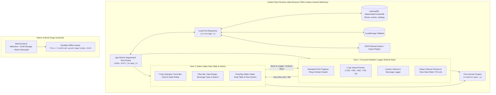

# System Architecture & Detailed Design Specification

**Document ID**: `SPEC-001-water-tracker`  
**Parent Requirements**: `REQ-SPEC-001` (`REQ-001` through `REQ-010`)  
**Sprint**: Sprint 01  
**Author**: System Architect  
**Approved By**: Tech Lead (Gate 1 Clearance)  
**Status**: 🟢 APPROVED  

---

## 1. System Topology & Data Flow



---

## 2. Data Schemas & Domain Models

### 2.1 Hydration Entry Entity (`HydrationEntry`)
```typescript
interface HydrationEntry {
  id: string;               // Unique ID e.g. "wt_1730350000000_a1b2c"
  amountMl: number;         // Positive integer in milliliters (1 to 5000)
  beverageType: 'water' | 'sparkling' | 'electrolyte' | 'tea' | 'coconut';
  vesselLabel: string;      // e.g. "Small Cup", "Glass", "Bottle", "Sports Flask", "Custom"
  date: string;             // Local ISO Date "YYYY-MM-DD"
  time: string;             // Local 24h Time "HH:MM"
  note: string;             // Optional user note (HTML-escaped on render)
  createdAt: number;        // Epoch timestamp (ms)
}
```

### 2.2 User Settings Entity (`UserSettings`)
```typescript
interface UserSettings {
  dailyGoalMl: number;      // Default: 2500 (valid range: 500 - 10000)
  unit: 'ml';               // Standardized milliliter display
  updatedAt: number;
}
```

### 2.3 Cross-Device Backup Envelope (`WaterBackupEnvelope`)
```typescript
interface WaterBackupEnvelope {
  app: 'AquaPulse-WaterIntakeTracker';
  version: '1.0.0';
  exportedAt: string;       // ISO 8601 timestamp
  schemaVersion: 1;
  recordCount: number;
  data: {
    entries: HydrationEntry[];
    settings: UserSettings;
  };
}
```

---

## 3. View Architecture & Navigation State Machine

To honor the Customer's design requirement (*"Know that its not necessary to just show entire water intake table per time/day at the start. There could be a simple logger at the start, then followed by some way to link to the data table"*):

1. **Primary View (`logger`) — Active on Startup**:
   - Displays the **Animated Liquid Progress Dial** (`SVG` ring with smooth stroke-dashoffset transition), Today's Intake (`ml`), Goal (`ml`), Remaining (`ml`), and Hydration Streak (`days`).
   - Displays **4 One-Tap Vessel Cards** (`+150 ml Cup`, `+250 ml Glass`, `+500 ml Bottle`, `+750 ml Flask`) and an **Undo Last** button.
   - Displays a collapsible/sleek **Custom Intake Bar** (Volume `ml`, Beverage Type, Date/Time, Note).
   - Displays a compact **"Today's Recent"** summary card showing up to 3 latest logs today and a prominent action link button: **`View Full Water Intake Data Table →`** (`#btn-link-to-table`).
2. **Secondary View (`history`) — Linked Data Table & Analytics**:
   - Reached by clicking **`View Full Water Intake Data Table →`** or the top segmented tab **`Data Table & History`** (mobile label: **`History`**).
   - Displays a **7-Day Hydration Progress Chart**, **Summary KPI Cards** (Filtered Total Volume, Daily Average, Goal Completion Days, Entry Count), **Search & Filter Controls** (Date preset: `Today`, `Last 7 Days`, `This Month`, `All Time`, Specific Date; Beverage Type; Search input), and the complete **Water Intake Data Table per Time/Day** with a **Daily Summary Rollup Table** and individual entry rows.
   - Includes a **`← Back to Hydration Logger`** button and integrates with `window.history.pushState` / `popstate` so pressing the **Android hardware back button** on the Data Table screen smoothly returns the user to the Hydration Logger screen before exiting the app.

---

## 4. Dual-Target Engineering Architecture (Web PWA & Native Android)

1. **Web PWA Target**:
   - Static ES6 modules (`js/app.js`, `js/waterLogic.js`, `js/storage.js`), Vanilla CSS (`css/style.css`), `manifest.json`, and `sw.js` (`CACHE_NAME = 'water-tracker-cache-v1.0.0'`).
   - GitHub Actions workflow (`.github/workflows/deploy.yml`) ready to deploy to GitHub Pages upon merge to `main`.
2. **Native Android Target (`android/`)**:
   - Package ID: `com.sumantmarathe.waterintaketracker` (`namespace = "com.waterintaketracker.app"`).
   - `MainActivity.kt` configures `WebView` with `javaScriptEnabled = true`, `domStorageEnabled = true`, `databaseEnabled = true`, and loads `file:///android_asset/www/index.html`.
   - `OnBackPressedCallback` checks if the web app is currently on the `history` (Data Table) view or can go back in history, returning to the `logger` view first before closing the activity.
   - `scripts/build-android.mjs` synchronizes all web assets into `android/app/src/main/assets/www` and runs Gradle to compile `assembleDebug`, `assembleRelease`, or `bundleRelease` (`.aab` for Google Play Console).

---

## 5. Gate 1 Pre-Flight External Dependency & Credentials Audit

- **External APIs / Third-Party Servers**: **NONE** required for Sprint 01 MVP.
- **Persistence**: 100% client-side IndexedDB (`WaterIntakeTrackerDB`) + `localStorage` fallback.
- **Privacy Policy**: Bundled locally at `privacy.html` for Google Play Console compliance.
- **Gate 1 Status**: **PASSED** &rarr; Cleared for Gate 2 Implementation (`TASK-003`).
